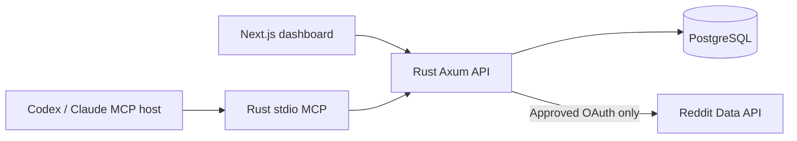

# Pain Intelligence Lab

**Rust + PostgreSQL + Next.js.** The main application uses a Rust (Axum/Tokio) backend, PostgreSQL, a TypeScript Next.js frontend, and a native Rust Model Context Protocol (MCP) server.

Analyze permitted Reddit discussions and other lawfully sourced customer evidence to identify recurring pain points, explore opportunities, and organize evidence-based research. The product can work with a compatible AI research host through MCP, but **does not claim to predict market demand**.

## Quick start

Requirements: Docker Engine and Docker Compose v2.

```bash
git clone https://github.com/savisaluwadana/Reddit-post-Analyzer.git
cd Reddit-post-Analyzer
cp .env.example .env
openssl rand -hex 32
```

Put the generated hex value in `TOKEN_ENCRYPTION_KEY_HEX` in `.env` and set a strong `POSTGRES_PASSWORD`.

**Reddit access requires separately approved developer app credentials.** Register an application, configure `REDDIT_CLIENT_ID`, `REDDIT_CLIENT_SECRET`, `REDDIT_REDIRECT_URI`, and a descriptive `REDDIT_USER_AGENT`. Set `REDDIT_API_APPROVED=true` only after receiving the required approval. Commercial access may require a separate agreement. The app does not scrape browser session cookies.

```bash
docker compose up --build -d --wait
```

Open **http://localhost:3000**. The app automatically applies PostgreSQL migrations on startup. Configure `REDDIT_REQUESTS_PER_MINUTE` and `REDDIT_USER_REQUESTS_PER_MINUTE` in `.env` if your approved app has stricter limits; provider-side restrictions always take precedence. Without approved Reddit OAuth credentials, the UI and service can start, but Reddit sign-in/collection is disabled.

To stop the app without destroying its new data: `docker compose down`. Never run `docker compose down -v` on a database you want to keep.

## What runs where

| Component | Technology | Path |
| --- | --- | --- |
| Application API | Rust, Axum, Tokio, SQLx | `api/` |
| Web dashboard | Next.js App Router, TypeScript, React | `web/` |
| Database | PostgreSQL 17 | `db/` |
| Research host bridge | Native Rust MCP JSON-RPC stdio server | `api/src/mcp/` |
| Integration tests | Docker + API / MCP scenarios | `scripts/test_mcp.sh` |
| Deployment | Compose, multi-stage Dockerfiles | `compose.yaml` |



## Features

- Reddit OAuth sign-in with encrypted tokens, server-issued sessions, refresh support, bounded post/comment requests and provider rate-limit handling.
- Evidence storage, research projects, thread-aware deterministic pain cluster scoring, reports, opportunities and queued research jobs.
- Host-assisted cross-source evidence research, search planning, visit/scraping bookkeeping, annotation/synthesis, quality checks, sourced market-sizing drafts, experiments, build plans and GTM workspaces.
- Native Rust MCP bridge exposing 57 established tool names/input schemas with revocable user-scoped API keys.
- Agent Research and MCP Integrations pages in the Next.js dashboard.
- Privacy & Settings workspace: research JSON export, per-evidence and per-project deletion, Reddit OAuth disconnect and provider token revocation, account deletion, and MCP API-key revocation.
- Server-side same-origin CSRF guard for cookie-authenticated mutations, safe OAuth callback origin checks, hardened response headers, short default Reddit evidence retention, PostgreSQL ownership constraints and background-job recovery.
- Shared PostgreSQL request budgets for Reddit Data API calls (default 30 requests/minute per app and 10 requests/minute per user), plus provider 429 backoff. These are conservative local limits, not permission to exceed Reddit's quotas.

## Connect a research host

First connect a Reddit account through the approved OAuth flow, then create a revocable key on **MCP Integrations**. Use the native Rust bridge:

```bash
PAIN_PLATFORM_API_URL=http://127.0.0.1:3000 \
PAIN_MCP_API_KEY=your_one_time_key \
cargo run --manifest-path api/Cargo.toml -- --mcp
```

Configure this command as the `stdio` process in your MCP host. Avoid committing tokens to version control. See [MCP host setup](docs/MCP.md) for a host configuration example and workflow.

## Development

Start PostgreSQL with Compose or another local database, configure the environment, then:

```bash
cd api && cargo test && cargo run
cd web && npm install && npm run dev
```

Run the commands in separate terminals. The Next.js development server proxies `/api/*` to Rust at localhost:4000. No Express server, MongoDB or Vite app is needed.

## Testing

Continuous integration runs Rust compilation and tests, Next.js typecheck/build, Docker Compose validation and live PostgreSQL + Rust + Next.js MCP integration, including ownership boundaries, CSRF rejection, JSON export, authorized deletion and research workflows.

```bash
cd api && cargo check --all-targets && cargo test
cd web && npm install && npm run typecheck && npm run build
```

## Safety and release boundaries

- **Reddit OAuth must be tested with a real, approved Reddit app** before enabling live collection. OAuth does not grant unrestricted scraping, bulk data access or commercial rights. Respect Reddit's terms and deletion requirements.
- The 57 MCP names and input schemas are implemented in Rust; some behaviors and result shapes differ from the older system. Legacy parity is not guaranteed.
- A host supplies its own browsing and model reasoning. Source text is untrusted data, not executable instructions. No embedded LLM API or autonomous browsing bypass is included.
- External-account security review, real OAuth/revocation tests, production content-deletion reconciliation, high-concurrency/load testing and deployment hardening remain required before public release.
- No historical MongoDB data is imported. This is a **fresh PostgreSQL application**. The former JavaScript implementation remains accessible in Git history.

Further details: [Architecture](docs/ARCHITECTURE.md) and [MCP integration](docs/MCP.md).
