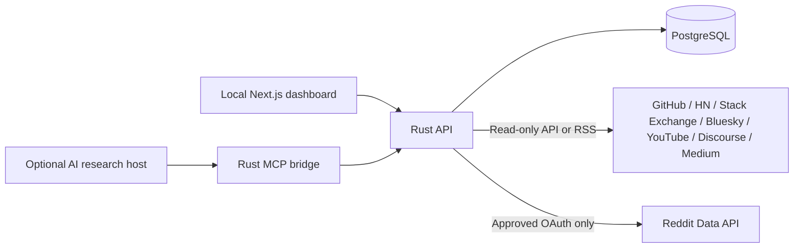

# Open Source Discovery Lab

> **Early community alpha · MIT licensed · local/self-hosted.** Join as a tester or contributor. Do not deploy this version as an internet-facing service.

**From community conversations to useful open-source projects.**

**Get started:** [Five-minute fictional demo](docs/DEMO.md) · [Contributing](CONTRIBUTING.md) · [Roadmap](docs/ROADMAP.md) · [Known limitations](#limitations) · [Give alpha feedback](https://github.com/savisaluwadana/Reddit-post-Analyzer/issues/new/choose)

This project analyzes short, source-linked observations so contributors can **investigate** recurring challenges and potential open-source contributions. Themes are provisional hypotheses, not endorsements, verified demand, or a substitute for reading the original discussions.

Open Source Discovery Lab is a locally operated research workspace for identifying recurring challenges, unmet needs, and opportunities to contribute practical software to the open-source ecosystem. Its **current intended use is individual and non-commercial**: organize permitted community evidence, understand recurring issues, and explore freely available tools that could help address them.

This project was previously presented as *Pain Intelligence Lab*. The GitHub repository URL is unchanged for continuity. The software's underlying collection and analysis capabilities are unchanged by this positioning update.

> **What this project does:** collect permitted discussions and other evidence, retain source references, group recurring themes, and help a developer evaluate ideas for useful open-source contributions. It does not represent Reddit, speak on behalf of communities, or claim that popularity scores prove a particular solution is needed.

## Community-first principles

- **Listen before building.** Explore what community members are describing, including alternative views and existing solutions.
- **Contribute openly.** Use findings to inspire projects that can be shared and improved with others. Identified ideas are proposals, not endorsements by Reddit users.
- **Respect community members.** Avoid profiling individuals, selling or redistributing Reddit content, unsolicited contact, or automated posting/voting.
- **Use permitted data sources.** Reddit access requires the operator's separately approved, read-only OAuth permissions. Do not use browser-cookie scraping or undocumented API workarounds.
- **Keep scope small.** The current setup is designed for a single local operator, with bounded requests and short default Reddit evidence retention.
- **Stay transparent.** Optional host-assisted research tools can also plan market comparisons, experiments, and project execution. Their presence does not constitute an authorization to use Reddit data commercially. If the project changes purpose, re-evaluate permissions before using Reddit-derived material for that purpose.

See [Purpose, scope, and data use](docs/PURPOSE_AND_DATA_USE.md) for the project's scope, permissions, and data-handling practices.

## What you can explore

1. Browse public GitHub Issues, Hacker News comments, Stack Overflow questions, Bluesky posts, YouTube comments, allowlisted Discourse forums, and Medium topic RSS using read-only connectors.
2. Optionally, when Reddit access is approved, collect bounded Reddit posts and thread comments through OAuth.
3. Record permitted evidence, retaining the source reference, or send authorized evidence from a connected MCP research host.
4. Group recurring workflow issues, accessibility gaps, missing functionality, and community needs.
5. Review source-linked findings and generate proposals for open-source projects or contributions.
6. Validate those ideas with independent research and community feedback before building.

The built-in categorization is heuristic, not a measurement of community support or proof that a solution will succeed. Live third-party connectivity depends on each provider's access terms and quotas; Reddit API access and live OAuth remain unverified.

## Quick start: try it without external API credentials

Requirements: Docker Engine, Docker Compose v2, OpenSSL, `curl` and `jq`. Source code is public and [MIT-licensed](LICENSE), but third-party discussions retain their own terms and licenses.

```bash
git clone https://github.com/savisaluwadana/Reddit-post-Analyzer.git
cd Reddit-post-Analyzer
cp .env.example .env
```

Generate three **different** secret values and paste them into `.env`:

```bash
openssl rand -hex 32 # TOKEN_ENCRYPTION_KEY_HEX (32 bytes, hex)
openssl rand -hex 32 # LOCAL_LOGIN_TOKEN (local sign-in secret)
openssl rand -hex 24 # POSTGRES_PASSWORD (safe alphanumeric hex)
```

Then run:

```bash
docker compose up --build -d --wait
bash scripts/try-demo.sh
```

The script inserts **six invented observations** (no scraping or API tokens) into an isolated demo project, runs the rule-based theme analysis, and prints the result. Open **http://localhost:3000**; enter your `LOCAL_LOGIN_TOKEN` to sign in. Go to **Evidence Library** or **Analyze & Discover**. See [the step-by-step walkthrough](docs/DEMO.md) for cleanup and troubleshooting.

Once that works, try **Community Sources** with a permitted public API. Source terms, quotas and availability still apply; [connector guide](docs/SOURCES.md).

## Manual setup details

To run the app without the demo, configure `.env` as described above and run `docker compose up --build -d --wait`. The application does not require Reddit API credentials for local research. Do not commit or share your `.env`.

**Local login:** Enter the generated `LOCAL_LOGIN_TOKEN` on the homepage. The shared local key creates a single research identity, not separate end-user accounts. It is deliberately limited to localhost `WEB_URL`; **do not publish the Docker ports or place it behind a public tunnel**.

**Optional Reddit connector:** Reddit collection still requires separately approved OAuth credentials (`REDDIT_CLIENT_ID`, `REDDIT_CLIENT_SECRET`, `REDDIT_REDIRECT_URI`, `REDDIT_USER_AGENT`). Set `REDDIT_API_APPROVED=true` only after approval. The other seven connectors do not depend on Reddit.

After configuring secrets, run `docker compose up --build -d --wait`. Open **http://localhost:3000**. Choose **Community Sources** to run a permitted source search, then **Evidence Library** or **Analyze & Discover** for analysis. Migrations apply automatically. To stop without deleting data, use `docker compose down` (not `down -v`). Provider terms and quotas take precedence over internal request budgets.

## Architecture

| Component | Technology | Location |
| --- | --- | --- |
| API and collector | Rust, Axum, Tokio, SQLx | `api/` |
| Local dashboard | Next.js, React, TypeScript | `web/` |
| Source evidence and research | PostgreSQL 17 | `db/` |
| Optional research host bridge | Rust MCP over JSON-RPC stdio | `api/src/mcp/` |
| Integration checks | Docker + application / MCP scenarios | `scripts/test_mcp.sh` |



### Current features

- Seven read-only connectors for GitHub Issues, Hacker News (third-party Algolia index), Stack Overflow, Bluesky, YouTube comments, allowlisted Discourse forums and Medium RSS.
- Optional, local-only token login so the research dashboard works without Reddit permissions.
- Read-only Reddit OAuth connector for bounded posts and comments, when separately approved.
- Evidence library, community research projects, source-reference tracking, theme clustering, saved findings, and background collection jobs.
- 57 existing MCP tool names for source planning, host-assisted evidence ingestion, research annotations, synthesis, validation, and follow-on project planning. Some historical tool results are not fully compatible.
- Personal data export, individual evidence/project deletion, account deletion, Reddit disconnect/token revocation, request budgets, and per-account MCP key management.

**AI/MCP transparency:** the optional connected host performs external browsing or model reasoning. Rust does not autonomously browse arbitrary websites or train models on Reddit content. Reddit-origin evidence must pass through the approved connector, not be disguised as manually imported or host-scraped data.

## Technical development

```bash
cd api && cargo check --all-targets && cargo test
cd web && npm install && npm run typecheck && npm run build
```

Run these in separate terminals when starting services directly. CI covers the Rust API, Next.js production build, Docker configuration and a PostgreSQL-backed integration flow. It does not establish approval or test real Reddit OAuth credentials.

See [Architecture](docs/ARCHITECTURE.md), [Source connector guide](docs/SOURCES.md), and [MCP host configuration](docs/MCP.md).

## License and data use

**Software license:** [MIT License](LICENSE) — this project's original source code is open source. The MIT license allows use, modification, redistribution, and commercial reuse of the code, subject to its license conditions.

**Current intended operation:** local, individual, non-commercial research. That describes how this application and its Reddit integration are currently intended to be used; it is **not** a restriction added to the MIT software license.

**Third-party data is separate from code.** The MIT license does not grant rights to Reddit posts, comments, user content, trademarks, or external datasets. Any access to Reddit content requires independently approved permissions and compliance with applicable platform and data-use terms. Commercial exploitation of Reddit-derived content or analysis may require separate authorization. Do not treat open-source licensing as approval to scrape Reddit or bypass access controls.

## Limitations

- Approved Reddit API access and live OAuth/revocation testing remain outstanding.
- Local login requires a deliberately configured 64-character random token and is limited to localhost; this is not a multi-tenant hosted login system.
- No Reddit login bypass, scraping workaround, or commercial data license is implemented.
- Scores and inferred themes should be checked against original sources and contradictory evidence.
- Real-world acceptance, concurrency/load evaluation, and production security review remain separate from passing CI.
- Historical MongoDB data is not imported; this is a fresh PostgreSQL application.
- Collection is one page per click, not continuous monitoring. Public adapters are **not yet live-certified** against every provider.
- Built-in topic analysis is keyword-based; the optional MCP host performs separate model reasoning.
- The GitHub release tag `v-1.0` is from an older codebase. New alpha release notes are a [draft](docs/ALPHA_RELEASE_NOTES.md), not a published stable release.

## Community and support

This is a call for **alpha testers and contributors**. Try the [fictional six-item demo](docs/DEMO.md), then tell us what succeeded or failed with the [alpha feedback issue template](https://github.com/savisaluwadana/Reddit-post-Analyzer/issues/new/choose). Please do not attach tokens or real private post text.

Start with [CONTRIBUTING](CONTRIBUTING.md) for PRs and tests, [ROADMAP](docs/ROADMAP.md) for high-impact tasks, [SUPPORT](SUPPORT.md) for help, [CODE_OF_CONDUCT](CODE_OF_CONDUCT.md) for participation, and [SECURITY](SECURITY.md) for **private** vulnerability reporting. Maintainers review contributions as time allows; no SLA is promised.
