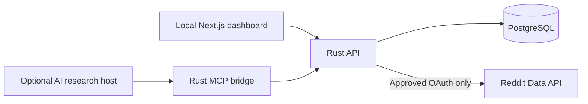

# Open Source Discovery Lab

**From community conversations to useful open-source projects.**

Open Source Discovery Lab is a locally operated research workspace for identifying recurring challenges, unmet needs, and opportunities to contribute practical software to the open-source ecosystem. Its **current intended use is individual and non-commercial**: organize permitted community evidence, understand recurring issues, and explore freely available tools that could help address them.

This project was previously presented as *Pain Intelligence Lab*. The GitHub repository URL is unchanged for continuity. The software's underlying collection and analysis capabilities are unchanged by this positioning update.

> **What this project does:** collect permitted discussions and other evidence, retain source references, group recurring themes, and help a developer evaluate ideas for useful open-source contributions. It does not represent Reddit, speak on behalf of communities, or claim that popularity scores prove a particular solution is needed.

## Community-first principles

- **Listen before building.** Explore what community members are describing, including alternative views and existing solutions.
- **Contribute openly.** Use findings to inspire projects that can be shared and improved with others. Identified ideas are proposals, not endorsements by Reddit users.
- **Respect community members.** Avoid profiling individuals, selling or redistributing Reddit content, unsolicited contact, or automated posting/voting.
- **Use permitted data sources.** Reddit access requires the operator's separately approved, read-only OAuth permissions. Do not use browser-cookie scraping or undocumented API workarounds.
- **Keep scope small.** The current setup is designed for a single local operator, with bounded requests and short default Reddit evidence retention.
- **Stay transparent.** Optional host-assisted research tools can also plan market comparisons, experiments, and project execution. Their presence does not constitute an authorization to use Reddit data commercially. If the project changes purpose, re-evaluate permissions before using Reddit-derived material for that purpose.

See [Purpose, scope, and data use](docs/PURPOSE_AND_DATA_USE.md) and [Reddit API request wording](docs/REDDIT_API_REQUEST.md).

## What you can explore

1. Select communities and, **when approved**, collect a bounded set of their public posts through Reddit OAuth.
2. Choose a thread to retrieve and examine permitted comments.
3. Record permitted evidence and its source, or send authorized evidence from a connected research host via MCP.
4. Group recurring workflow issues, accessibility gaps, missing functionality, integration barriers, or other community needs.
5. Review source-linked findings and form ideas for open-source utilities, integrations, documentation, accessibility improvements, and community tools.
6. Validate those ideas with independent research and community feedback before building.

The built-in categorization is heuristic, not a measurement of community support or proof that a solution will succeed. Reddit API access, login, and live Reddit collection have **not** been externally verified with approved credentials.

## Run locally

Requirements: Docker Engine and Docker Compose v2.

```bash
git clone https://github.com/savisaluwadana/Reddit-post-Analyzer.git
cd Reddit-post-Analyzer
cp .env.example .env
openssl rand -hex 32
```

Add the generated value to `TOKEN_ENCRYPTION_KEY_HEX` in `.env`; set a strong `POSTGRES_PASSWORD`.

**Current sign-in depends on Reddit OAuth.** Before first use through the dashboard, you need an approved Reddit developer application and `REDDIT_CLIENT_ID`, `REDDIT_CLIENT_SECRET`, `REDDIT_REDIRECT_URI`, and an appropriate `REDDIT_USER_AGENT`. Set `REDDIT_API_APPROVED=true` **only after approval**. These settings do not themselves authorize access. Without them, the stack starts but browser sign-in and collection remain unavailable; local-only sign-in is not yet implemented.

```bash
docker compose up --build -d --wait
```

Open **http://localhost:3000**. Database migrations apply automatically. The default Reddit request budgets are 30 requests/minute per app and 10 requests/minute per user; provider terms and actual limits take precedence. To stop without deleting data, use `docker compose down` (not `down -v`).

## Architecture

| Component | Technology | Location |
| --- | --- | --- |
| API and collector | Rust, Axum, Tokio, SQLx | `api/` |
| Local dashboard | Next.js, React, TypeScript | `web/` |
| Source evidence and research | PostgreSQL 17 | `db/` |
| Optional research host bridge | Rust MCP over JSON-RPC stdio | `api/src/mcp/` |
| Integration checks | Docker + application / MCP scenarios | `scripts/test_mcp.sh` |



### Current features

- Read-only Reddit OAuth connector for bounded community posts and comments, when separately approved.
- Evidence library, community research projects, source-reference tracking, theme clustering, saved findings, and background collection jobs.
- 57 existing MCP tool names for source planning, host-assisted evidence ingestion, research annotations, synthesis, validation, and follow-on project planning. Some historical tool results are not fully compatible.
- Personal data export, individual evidence/project deletion, account deletion, Reddit disconnect/token revocation, request budgets, and per-account MCP key management.

**AI/MCP transparency:** the optional connected host performs external browsing or model reasoning. Rust does not autonomously browse arbitrary websites or train models on Reddit content. Reddit-origin evidence must pass through the approved connector, not be disguised as manually imported or host-scraped data.

## Technical development

```bash
cd api && cargo check --all-targets && cargo test
cd web && npm install && npm run typecheck && npm run build
```

Run these in separate terminals when starting services directly. CI covers the Rust API, Next.js production build, Docker configuration and a PostgreSQL-backed integration flow. It does not establish approval or test real Reddit OAuth credentials.

See [Architecture](docs/ARCHITECTURE.md) and [MCP host configuration](docs/MCP.md).

## Current use and software licensing

The **intended present use of the application and requested Reddit data access is local, individual, and non-commercial**. This statement describes the proposed operation; it is **not** a grant of rights to Reddit data and is **not** a software license.

The source is publicly visible, but this repository **does not currently include an open-source LICENSE file**. Choose and add an appropriate OSI-approved license before describing the repository's code as legally open-source or inviting redistribution. Open-source software projects inspired by research can be separately licensed.

Any later commercial product, paid research service, redistribution, or broader application deployment would require a new review of Reddit's terms and any separate permission required. We do not claim API approval, exemption from Reddit's terms, or authorization for automated scraping.

## Limitations

- Approved Reddit API access and live OAuth/revocation testing remain outstanding.
- The dashboard does not yet offer independent local-only authentication.
- No Reddit login bypass, scraping workaround, or commercial data license is implemented.
- Scores and inferred themes should be checked against original sources and contradictory evidence.
- Real-world acceptance, concurrency/load evaluation, and production security review remain separate from passing CI.
- Historical MongoDB data is not imported; this is a fresh PostgreSQL application.
