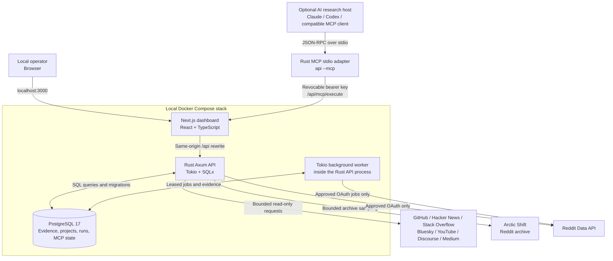
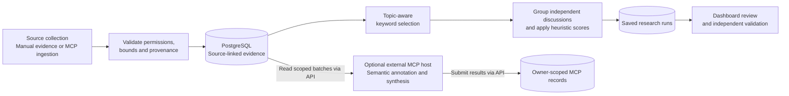

# Open Source Discovery Lab

> **Early community alpha · MIT licensed · local/self-hosted.** Join as a tester or contributor. Do not deploy this
> version as an internet-facing service.

**From community conversations to useful open-source projects.**

**Get started:** [Reddit archive quick start](docs/ARCTIC_SHIFT.md) · [Five-minute fictional demo](docs/DEMO.md) ·
[Contributing](CONTRIBUTING.md) · [Roadmap](docs/ROADMAP.md) · [Architecture](#architecture) ·
[Known limitations](#limitations) ·
[Give alpha feedback](https://github.com/savisaluwadana/Pain-Point-Analyzer/issues/new/choose)

This project analyzes short, source-linked observations so contributors can **investigate** recurring challenges and
potential open-source contributions. Themes are provisional hypotheses, not endorsements, verified demand, or a
substitute for reading the original discussions.

Open Source Discovery Lab is a locally operated research workspace for identifying recurring challenges, unmet needs,
and opportunities to contribute practical software to the open-source ecosystem. Its **current intended use is
individual and non-commercial**: organize permitted community evidence, understand recurring issues, and explore freely
available tools that could help address them.

This project was previously presented as _Pain Intelligence Lab_. The repository is now named **Pain-Point-Analyzer**;
the application is presented as **Open Source Discovery Lab**.

> **What this project does:** collect permitted discussions and other evidence, retain source references, group
> recurring themes, and help a developer evaluate ideas for useful open-source contributions. It does not represent
> Reddit, speak on behalf of communities, or claim that popularity scores prove a particular solution is needed.

## Community-first principles

- **Listen before building.** Explore what community members are describing, including alternative views and existing
  solutions.
- **Contribute openly.** Use findings to inspire projects that can be shared and improved with others. Identified ideas
  are proposals, not endorsements by Reddit users.
- **Respect community members.** Avoid profiling individuals, selling or redistributing Reddit content, unsolicited
  contact, or automated posting/voting.
- **Use permitted data sources.** Direct Reddit API access requires separately approved OAuth permissions. The optional
  Arctic Shift connector reads a third-party archive without Reddit credentials; its availability does not grant
  content-use rights. No browser cookies are used.
- **Keep scope small.** The current setup is designed for a single local operator, with bounded requests and short
  default Reddit evidence retention.
- **Stay transparent.** Optional host-assisted research tools can also plan market comparisons, experiments, and project
  execution. Their presence does not constitute an authorization to use Reddit data commercially. If the project changes
  purpose, re-evaluate permissions before using Reddit-derived material for that purpose.

See [Purpose, scope, and data use](docs/PURPOSE_AND_DATA_USE.md) for the project's scope, permissions, and data-handling
practices.

## What you can explore

1. Browse public GitHub Issues, Hacker News comments, Stack Overflow questions, Bluesky posts, YouTube comments,
   allowlisted Discourse forums, and Medium topic RSS using read-only connectors.
2. Collect bounded Reddit archive samples through **Arctic Shift**, without Reddit OAuth, cookies or browser automation.
   Direct Reddit API collection remains a separate option when approved.
3. Record permitted evidence, retaining the source reference, or send authorized evidence from a connected MCP research
   host.
4. Group recurring workflow issues, accessibility gaps, missing functionality, and community needs.
5. Review source-linked findings and generate proposals for open-source projects or contributions.
6. Validate those ideas with independent research and community feedback before building.

The built-in categorization is heuristic, not a measurement of community support or proof that a solution will succeed.
Live third-party connectivity depends on each provider's access terms and quotas; Reddit API access and live OAuth
remain unverified.

## Quick start: try it without external API credentials

Requirements: Docker Engine, Docker Compose v2, OpenSSL, `curl` and `jq`. Source code is public and
[MIT-licensed](LICENSE), but third-party discussions retain their own terms and licenses.

```bash
git clone https://github.com/savisaluwadana/Pain-Point-Analyzer.git
cd Pain-Point-Analyzer
cp .env.example .env
```

Generate three **different** secret values and paste them into `.env`:

```bash
openssl rand -hex 32 # TOKEN_ENCRYPTION_KEY_HEX (32 bytes, hex)
openssl rand -hex 32 # LOCAL_LOGIN_TOKEN (local sign-in secret)
openssl rand -hex 24 # POSTGRES_PASSWORD (safe alphanumeric hex)
```

Then run:

```bash
docker compose up --build -d --wait
bash scripts/try-demo.sh
```

The script inserts **six invented observations** (no scraping or API tokens) into an isolated demo project, runs the
rule-based theme analysis, and prints the result. Open **http://localhost:3000**; enter your `LOCAL_LOGIN_TOKEN` to sign
in. Go to **Evidence Library** or **Analyze & Discover**. See [the step-by-step walkthrough](docs/DEMO.md) for cleanup
and troubleshooting.

### First Reddit archive collection

1. Open **Community Sources** and select **Reddit archive (Arctic Shift)**.
2. Enter `smallbusiness` without `r/`. Leave the phrase and post ID blank; choose **30 days** and **Highest archived
   scores**.
3. Collect once. The dashboard fetches up to **100 recent candidates** and saves up to **10 eligible records**. Inspect
   them in **Evidence Library**, then open **Analyze & Discover**.
4. Wait at least **10 seconds** before another collection and respect any longer provider backoff. Try **Middle of score
   ranking** for a different selection from the recent sample.

These are archived scores within one recent page, not Reddit's live top posts for the month. A batch of 100 records is
one bounded request, not a guarantee against rate limits. Start with one subreddit; expand to at most ten sequentially
after checking the results.

For an agent-driven run, use `collect_reddit_archive` through the [MCP bridge](docs/MCP.md); no browser connector is
needed. See [archive setup, examples and troubleshooting](docs/ARCTIC_SHIFT.md) or the full
[connector guide](docs/SOURCES.md).

## Manual setup details

To run the app without the demo, configure `.env` as described above and run `docker compose up --build -d --wait`. The
application does not require Reddit API credentials for local research. Do not commit or share your `.env`.

**Local login:** Enter the generated `LOCAL_LOGIN_TOKEN` on the homepage. The shared local key creates a single research
identity, not separate end-user accounts. It is deliberately limited to localhost `WEB_URL`; **do not publish the Docker
ports or place it behind a public tunnel**.

**Browser-free archive pilot:** Choose **Reddit archive (Arctic Shift)** under Sources, or call `collect_reddit_archive`
through MCP. See the [setup, sampling limits and test steps](docs/ARCTIC_SHIFT.md). No Reddit OAuth credentials are
needed for archive collection.

**Optional direct Reddit connector:** Direct Reddit API collection requires separately approved OAuth credentials
(`REDDIT_CLIENT_ID`, `REDDIT_CLIENT_SECRET`, `REDDIT_REDIRECT_URI`, `REDDIT_USER_AGENT`). Set `REDDIT_API_APPROVED=true`
only after approval. Arctic Shift and the other seven source adapters do not use these OAuth credentials.

After configuring secrets, run `docker compose up --build -d --wait`. Open **http://localhost:3000**. Choose **Community
Sources** to run a permitted source search, then **Evidence Library** or **Analyze & Discover** for analysis. Migrations
apply automatically. To stop without deleting data, use `docker compose down` (not `down -v`). Provider terms and quotas
take precedence over internal request budgets.

## Architecture

Open Source Discovery Lab is a **local, three-service Docker Compose application**: a Next.js dashboard, a Rust API, and
PostgreSQL. The Rust API also runs the Tokio background worker; the optional MCP adapter runs on the research host, not
as another Compose service.

### System overview



| Component                     | Technology                         | Location / responsibility                                                       |
| ----------------------------- | ---------------------------------- | ------------------------------------------------------------------------------- |
| Dashboard and API proxy       | Next.js, React, TypeScript         | `web/` — local interface and same-origin `/api/*` forwarding                    |
| HTTP API and collectors       | Rust, Axum, Tokio, SQLx            | `api/` — authentication, source policies, evidence, research, and MCP execution |
| Evidence and research storage | PostgreSQL 17                      | `db/` — SQL migrations; evidence, projects, runs, job state, and revocable keys |
| Background job loop           | Tokio task in the Rust API process | `api/src/jobs.rs` — leased, approved direct-Reddit-OAuth collection jobs        |
| Optional MCP host bridge      | Rust, JSON-RPC 2.0 over stdio      | `api/src/mcp/` — calls the same API with a revocable per-account key            |
| Integration checks            | GitHub Actions, Docker Compose     | `scripts/test_mcp.sh`, `.github/workflows/ci.yml`                               |

### How evidence becomes a finding



The **built-in analysis is deterministic and keyword-based**, not autonomous AI inference. A connected MCP host can
perform its own permitted browsing and semantic reasoning, while Rust validates and stores submitted evidence IDs,
annotations, and research state. Scores represent investigation priorities, **not verified market demand**.

**Request and security boundaries:** the browser reaches only the loopback-bound Next.js port; Next.js rewrites `/api/*`
to the internal Rust API. Browser mutations require authenticated same-origin sessions; MCP requests use revocable
bearer credentials. Providers have bounded request and retention policies. **Arctic Shift collection runs on demand; the
background worker is only for separately approved direct Reddit OAuth.** Neither archive access nor a passing CI run
grants third-party content-use permissions.

For module-level design, database ownership, source budgets, authentication, and security details, see
[the full architecture documentation](docs/ARCHITECTURE.md), the [connector guide](docs/SOURCES.md), and the
[MCP workflow](docs/MCP.md).

### Current features

- Eight read-only source connectors: Arctic Shift Reddit archives, GitHub Issues, Hacker News (third-party Algolia
  index), Stack Overflow, Bluesky, YouTube comments, allowlisted Discourse forums and Medium RSS.
- Optional, local-only token login so the research dashboard works without Reddit permissions.
- Read-only Reddit OAuth connector for bounded posts and comments, when separately approved.
- Evidence library, community research projects, source-reference tracking, theme clustering, saved findings, and
  background collection jobs for the direct OAuth Reddit connector. Archive collection is on demand through Sources or
  MCP.
- 58 MCP tools, including `collect_reddit_archive`, for collection, source planning, host-assisted evidence ingestion,
  research annotations, synthesis, validation, and follow-on project planning. Some historical tool results are not
  fully compatible.
- Personal data export, individual evidence/project deletion, account deletion, Reddit disconnect/token revocation,
  request budgets, and per-account MCP key management.

**AI/MCP transparency:** the optional connected host performs external browsing or model reasoning. Rust does not
autonomously browse arbitrary websites or train models on Reddit content. Reddit-origin evidence enters through the
dedicated archive collector or the approved direct Reddit connector; generic manual/MCP ingestion refuses Reddit
records. Archive fetching runs in Rust; optional model reasoning runs in the connected host.

## Technical development

```bash
(cd api && cargo check --all-targets --locked && cargo test --locked)
(cd web && npm ci && npm run typecheck && npm run build)
```

Run these checks from the repository root. CI covers the Rust API, Next.js production build, Docker configuration and a
PostgreSQL-backed integration flow. It does not establish approval or test real Reddit OAuth credentials.

See [Architecture](docs/ARCHITECTURE.md), [Source connector guide](docs/SOURCES.md), and
[MCP host configuration](docs/MCP.md).

## License and data use

**Software license:** [MIT License](LICENSE) — this project's original source code is open source. The MIT license
allows use, modification, redistribution, and commercial reuse of the code, subject to its license conditions.

**Current intended operation:** local, individual, non-commercial research. That describes how this application and its
Reddit integration are currently intended to be used; it is **not** a restriction added to the MIT software license.

**Third-party data is separate from code.** The MIT license does not grant rights to Reddit posts, comments, user
content, trademarks, or external datasets. Any access to Reddit content requires independently approved permissions and
compliance with applicable platform and data-use terms. Commercial exploitation of Reddit-derived content or analysis
may require separate authorization. Do not treat open-source licensing as approval to scrape Reddit or bypass access
controls.

## Limitations

- Approved Reddit API access and live OAuth/revocation testing remain outstanding.
- Local login requires a deliberately configured 64-character random token and is limited to localhost; this is not a
  multi-tenant hosted login system.
- No Reddit login bypass, scraping workaround, or commercial data license is implemented.
- Scores and inferred themes should be checked against original sources and contradictory evidence.
- Real-world acceptance, concurrency/load evaluation, and production security review remain separate from passing CI.
- Historical MongoDB data is not imported; this is a fresh PostgreSQL application.
- Source collection is one page per action, not continuous monitoring. Arctic Shift may lag or omit content; archived
  rankings and current deletions are not verified. A small archive smoke test passed, but adapters are **not yet
  live-certified** against every provider.
- Built-in topic analysis is keyword-based; the optional MCP host performs separate model reasoning.
- The GitHub release tag `v-1.0` is from an older codebase. New alpha release notes are a
  [draft](docs/ALPHA_RELEASE_NOTES.md), not a published stable release.

## Community and support

This is a call for **alpha testers and contributors**. Try the [fictional six-item demo](docs/DEMO.md), then tell us
what succeeded or failed with the
[alpha feedback issue template](https://github.com/savisaluwadana/Pain-Point-Analyzer/issues/new/choose). Please do not
attach tokens or real private post text.

Start with [CONTRIBUTING](CONTRIBUTING.md) for PRs and tests, [ROADMAP](docs/ROADMAP.md) for high-impact tasks,
[SUPPORT](SUPPORT.md) for help, [CODE_OF_CONDUCT](CODE_OF_CONDUCT.md) for participation, and [SECURITY](SECURITY.md) for
**private** vulnerability reporting. Maintainers review contributions as time allows; no SLA is promised.
