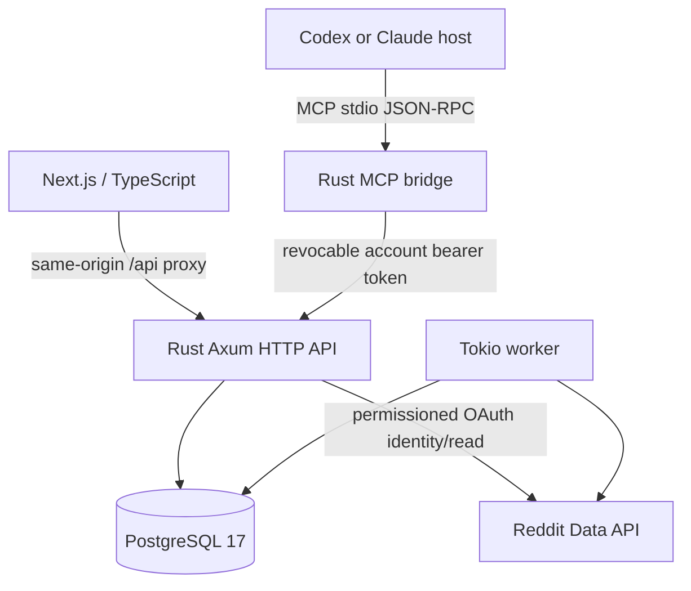

# Pain Intelligence Lab — Rust architecture

## System boundary

All API, persistence, background worker logic, and MCP protocol handling are in Rust. The web UI uses TypeScript/React because Next.js is a JavaScript-framework frontend; **a Rust backend does not mean the repository contains no JavaScript/TypeScript**.

## Modules

- `api/src/main.rs` — Axum routing, configuration, database connection, health and background tasks.
- `api/src/oauth.rs` — CSRF state, OAuth code exchange, encrypted credentials, sessions, refresh and logout.
- `api/src/reddit.rs` — authenticated Reddit API collection for bounded posts and comments.
- `api/src/research.rs` — owner-scoped projects, evidence, scans, reports and opportunities.
- `api/src/scoring.rs` — deterministic prioritization, including independent thread grouping.
- `api/src/jobs.rs` — PostgreSQL research-job leases, retry backoff and Reddit evidence cleanup.
- `api/src/mcp/` — MCP stdio server, 57-tool dispatcher, API keys, evidence and host-driven structured research.
- `api/src/mcp_catalog.json` — original tool name / input schema catalog.

## Persistent data

Migrations in `db/` define users, Reddit OAuth credentials, opaque session hashes, per-user research data, background jobs, and revocable MCP API keys. `mcp_records` stores user-owned jobs, search memory, host annotations, synthesized runs and workspaces with optimistic concurrency control.

This is a **fresh PostgreSQL database**, not a historical data import. Deleting an account cascades through its records. Production deployments must also reconcile deleted Reddit content promptly and review backups/log retention.

## Approved Reddit flow

1. Operator configures a registered, approved Reddit OAuth app and its access permissions.
2. The user authorizes `identity read`; Rust checks state, exchanges a code and stores encrypted tokens.
3. Rust issues a random HttpOnly session cookie; only its SHA-256 digest is stored.
4. User-approved Reddit requests use bearer tokens. Refresh occurs server-side, not in the browser.
5. Collector bounds source requests, observes 429s, retains source provenance and removes expired Reddit evidence.
6. MCP host ingestion **cannot masquerade as authorized Reddit collection**.

The `REDDIT_API_APPROVED` setting is an operator declaration only. It does not grant permission from Reddit.

## MCP workflow

A connected host can use the Rust MCP server to plan searches, ingest permitted external evidence, analyze signals, record research jobs, attach annotations to real evidence IDs, synthesize grounded clusters, and plan validation experiments, builds and GTM. Host browsing is external to the server. It must obey site restrictions and avoid prompt injection. Some input/output behavior from the historical JavaScript implementation is not byte-for-byte compatible.

## Verification

CI tests Rust, Next.js, Compose and the live web→API→database→MCP workflow, including separate research identities. Before public production, run real OAuth tests with an approved app, perform load/security tests, and check deletion/revocation and rate-limit policies.
