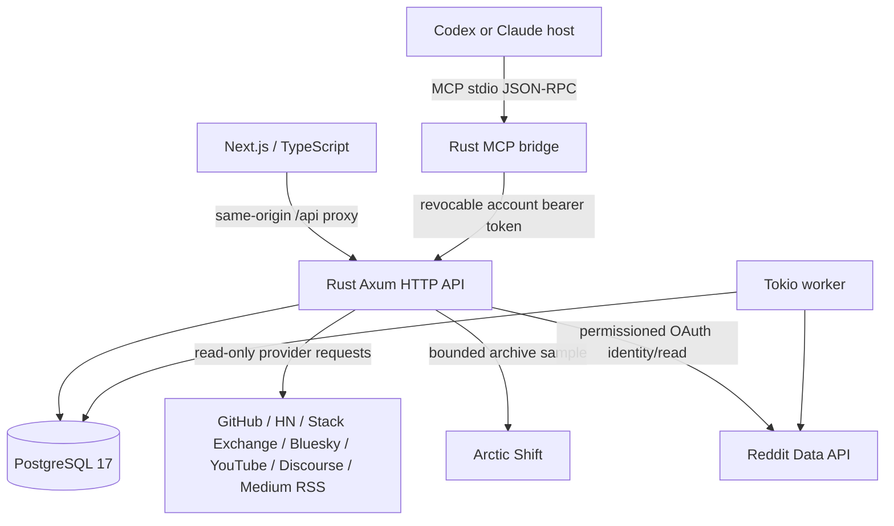

# Open Source Discovery Lab — Rust architecture

## Purpose and operator scope

Open Source Discovery Lab is currently intended for individual, local, non-commercial research into recurring needs discussed in online communities, with the aim of identifying possible open-source software contributions. The existing implementation includes broader analytical modules, but these do not authorize commercial use of Reddit data. Read the scope and permissions in [Purpose, scope, and data use](PURPOSE_AND_DATA_USE.md).

## System boundary

All API, persistence, background worker logic, and MCP protocol handling are in Rust. The web UI uses TypeScript/React because Next.js is a JavaScript-framework frontend; **a Rust backend does not mean the repository contains no JavaScript/TypeScript**.

## Modules

- `api/src/main.rs` — Axum routing, configuration, database connection, health and background tasks.
- `api/src/oauth.rs` — CSRF state, OAuth code exchange, encrypted credentials, sessions, refresh and logout.
- `api/src/local_auth.rs` — opt-in high-entropy localhost-only login independent of Reddit.
- `api/src/sources.rs` — fixed-host, read-only provider adapters, bounded evidence persistence, and source budgets.
- `api/src/archive.rs` — Arctic Shift sampling, local ranking, response validation and global request pacing.
- `api/src/reddit.rs` — authenticated Reddit API collection for bounded posts and comments.
- `api/src/research.rs` — owner-scoped projects, evidence, scans, reports and opportunities.
- `api/src/scoring.rs` — deterministic prioritization, including independent thread grouping.
- `api/src/jobs.rs` — PostgreSQL research-job leases, retry backoff and Reddit evidence cleanup.
- `api/src/mcp/` — MCP stdio server, 58-tool dispatcher, API keys, evidence and host-driven structured research.
- `api/src/mcp_catalog.json` — tool name / input schema catalog, including `collect_reddit_archive`.

## Persistent data

Migrations in `db/` define users, Reddit OAuth credentials, opaque session hashes, per-user research data, background jobs, and revocable MCP API keys. Migration `007_archive_provider.sql` adds the shared archive request budget. `mcp_records` stores user-owned jobs, search memory, host annotations, synthesized runs and workspaces with optimistic concurrency control.

This is a **fresh PostgreSQL database**, not a historical data import. Deleting an account cascades through its records. Production deployments must also reconcile deleted Reddit content promptly and review backups/log retention.

## Multi-source collection and local login

A single authenticated user can discover public evidence from eight connectors through `GET /api/sources` and `POST /api/sources/collect`. Provider hosts are fixed, except for explicitly allowlisted Discourse forum hostnames. The seven non-archive adapters forbid redirects and cap provider payloads to 1 MB per request. Requests require same-origin browser sessions; the seven non-archive adapters use per-account/source PostgreSQL budgets of four requests per minute, with provider quotas taking precedence. Evidence is deduplicated per owner/source/source ID and contains a short, source-linked excerpt.

If `LOCAL_LOGIN_TOKEN` is configured with a new 32-byte hex secret, the operator can sign in locally without Reddit access. The API accepts local login only when `WEB_URL` is on localhost, sets a seven-day HttpOnly cookie, and creates a single local research identity. Do not deploy local-token login on a public internet origin. This workspace identity supports archive collection but grants no direct Reddit API access or rights to underlying content.

See [Source connectors](SOURCES.md) for credential, quota and attribution limitations.

## Archive collection flow

`POST /api/sources/collect` with `source: arctic-shift` and MCP `collect_reddit_archive` call the same collector. It validates the subreddit and sampling bounds, checks project ownership, reserves a global PostgreSQL budget slot, then requests one page from a fixed Arctic Shift HTTPS endpoint. The client rejects redirects, requires JSON, and enforces a 20-second timeout and 4 MiB payload cap.

The collector filters invalid, marked-deleted, duplicate and out-of-window records, ranks the remaining sample locally, and upserts short evidence per owner/source/ID. Source kinds are `reddit-archive` and `reddit-archive-comment`. Thread grouping treats posts and comments from one thread as one independent story, including across direct and archive sources.

Request starts are spaced at least 10 seconds apart across workers. Provider 429/503 responses extend backoff; 401/403 pause requests for at least an hour. There are no automatic retries or fallback providers. Archive collection runs on demand; the background worker still collects through direct Reddit OAuth only. See [sampling semantics](ARCTIC_SHIFT.md).

## Approved Reddit flow

1. Operator configures a registered, approved Reddit OAuth app and its access permissions.
2. The user authorizes `identity read`; Rust checks state, exchanges a code and stores encrypted tokens.
3. Rust issues a random HttpOnly session cookie; only its SHA-256 digest is stored.
4. User-approved Reddit requests use bearer tokens. Refresh occurs server-side, not in the browser.
5. Collector bounds source requests, observes 429s, retains source provenance and removes expired Reddit evidence.
6. MCP host ingestion **cannot masquerade as authorized Reddit collection**.

Permanent direct Reddit API access denials (401/403) surface as HTTP 424. Background jobs fail without retrying these denials; temporary failures retain bounded retries and backoff.

The `REDDIT_API_APPROVED` setting is an operator declaration only. It does not grant permission from Reddit.

## MCP workflow

A connected host can use the Rust MCP server to plan searches, ingest permitted external evidence, analyze signals, record research jobs, attach annotations to real evidence IDs, synthesize grounded clusters, and plan validation experiments, builds and GTM. Host browsing is external to the server. It must obey site restrictions and avoid prompt injection. Some input/output behavior from the historical JavaScript implementation is not byte-for-byte compatible.

## Verification

CI tests Rust, Next.js, Compose and the local web→API→database→MCP workflow, including separate research identities. Archive parser tests use offline fixtures; an explicit PostgreSQL contract test checks persistence, owner isolation and shared pacing. The live archive smoke test is opt-in and excluded from normal CI. Before public production, run real OAuth tests with an approved app, perform load/security tests, and check deletion/revocation and rate-limit policies.

## Security and privacy controls

Cookie-authenticated POST/PUT/PATCH/DELETE requests must carry an Origin that exactly matches the configured `WEB_URL`. Requests carrying only MCP bearer credentials do not rely on browser cookies, so they use bearer authentication independently. HTTPS deployment requires `COOKIE_SECURE=true` and a matching OAuth callback origin. X-Frame-Options and other standard browser security response headers are set in Next.js.

The Privacy & Settings UI supports owner-scoped JSON export without OAuth secrets or raw direct/archive Reddit titles and bodies, per-item evidence deletion, project deletion (preserving unassigned evidence), Reddit app disconnect with OAuth revocation, and account deletion. Account deletion is not blocked if a provider revocation attempt fails; the user is notified to revoke the app from Reddit's account settings. Deleted-user rows cascade through their research and API keys.

For direct OAuth collection, a connection row is locked in the same transaction as Reddit evidence persistence. This ensures an in-progress collector cannot write Reddit data after disconnect has removed its credentials; disconnection also removes queued Reddit-only jobs. It does not delete independently collected archive evidence. Archive data uses `REDDIT_RETENTION_DAYS` (default seven, bounded to 1–30) and can also be removed through individual evidence or account deletion. Host-created research summaries may still reference historical evidence IDs, so delete the whole account to erase them too.

Provider-side Reddit API usage has a shared PostgreSQL request budget for all workers and each user, with bounded provider rate-limit backoff. Lease cleanup marks abandoned final-attempt research jobs failed instead of leaving them running indefinitely. Request budgets are conservative internal guardrails, not Reddit approval or quota guarantees.
