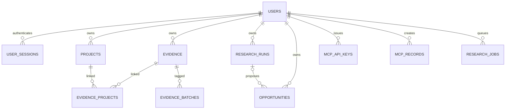
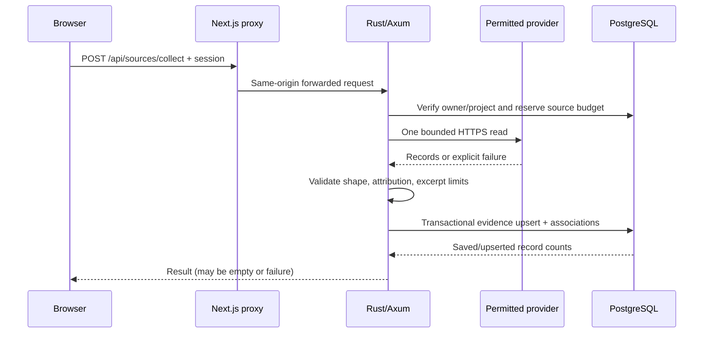
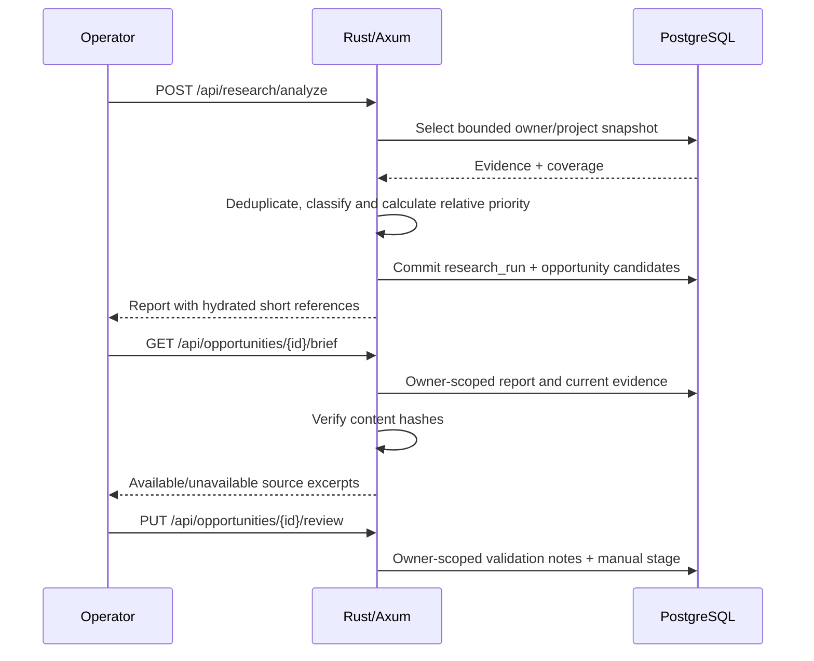

# Data model and transaction flows

PostgreSQL 17 is the only persistence service in the default Compose stack.
The API applies additive, ordered SQLx migrations from `db/` at startup.
This is an architectural overview; the SQL migration files are authoritative.

## Entity relationships

## Core tables

| Table | Purpose | Ownership, lifecycle and special rules |
| --- | --- | --- |
| `users` | Local research identity / optional approved Reddit identity | Deleting a user cascades owned records |
| `user_sessions` | Hashed cookie sessions with expiry | Sessions never expose their raw secret from SQL |
| `reddit_credentials` | Encrypted, optionally refreshable approved OAuth credentials | Linked to owner; disconnect attempts remote revocation |
| `projects` | Human-named research scopes | Deleted projects do not necessarily delete associated evidence |
| `evidence` | Source ID, URL, short title/body, timestamp and provider metadata | Uniqueness by `(owner_id,source_kind,source_id)` |
| `evidence_projects` | Many-to-many links between evidence and projects | Owner-scoped composite key; migration 008 |
| `evidence_batches` | Explicit batching for MCP/research scopes | Owner-scoped composite key; migration 008 |
| `research_runs` | Historical `report` JSONB, topic, run status | Contains counts and evidence identifiers/hashes, not long copied quotations |
| `opportunities` | Ranked candidate categories plus manual review | The decision and notes are separate from inferred score; migration 009 |
| `research_jobs` | Leased worker jobs for independently approved direct Reddit API | Includes retry/backoff information |
| `mcp_api_keys` | Revocable hashed bearer credentials | One-time key disclosure, owner-scoped |
| `mcp_records` | Versioned host-job/run/workspace JSONB | Used for optional host-led research state |
| `source_request_budgets` | Per-user, per-source connector request budgets | Prevents bursting beyond local four/minute setting |
| `archive_provider_budget` | Global archive-provider pacing/backoff | Shared across workers |

See [migration history](https://github.com/savisaluwadana/Pain-Point-Analyzer/tree/main/db)
and [database migration notes](https://github.com/savisaluwadana/Pain-Point-Analyzer/blob/main/db/README.md).
The historical missing migration number `002` is intentional. Never
renumber an applied migration.

## Data flow: source collection

For archive requests, the global provider pacing table is used instead
of the normal four/minute per-source budget. Do not treat a third-party
archive as an authorized commercial license.

## Data flow: analysis and opportunity review

`keywords-v2` performs deterministic, limited negation-aware keyword
matching. Thread/repost merging reduces some duplication, but cannot
guarantee statistically independent samples. Its priority percentile is
relative to a single run only. The embedding-based analyzer is still a
[proposal](ANALYSIS_DESIGN.md).

## Retention and deletion

Source excerpts are intentionally short. Environment-configured
`SOURCE_RETENTION_DAYS` and `REDDIT_RETENTION_DAYS` default to seven days,
with provider-specific policy and a supported 1–30 day range. The internal
cleanup task removes expired source records; then hash-based report
hydration marks stale/deleted excerpts unavailable. Saved scores may
remain as historical numeric summaries, not automatically recomputed.

Exports omit secret material and exclude Reddit post/comment body text.
Account deletion cascades local records; provider revocation may require
manual follow-up if it cannot be confirmed. See [data use](PURPOSE_AND_DATA_USE.md)
and [operations](OPERATIONS.md).

## Transactional and concurrency boundaries

- Provider evidence is upserted by canonical owner/source/ID; evidence-project
  associations are inserted transactionally.
- Reports and opportunities are inserted in one database transaction.
- An analysis semaphore admits one CPU-heavy analysis; others receive 429.
- Worker jobs use leases, retry limits and backoff rather than unbounded execution.
- Revocable MCP keys and host records are owner-scoped; some host-provided
  semantic results are JSONB, not the built-in keyword engine.

A successful unit test is not a substitute for validating third-party
provider terms, production security, or backup recovery.
