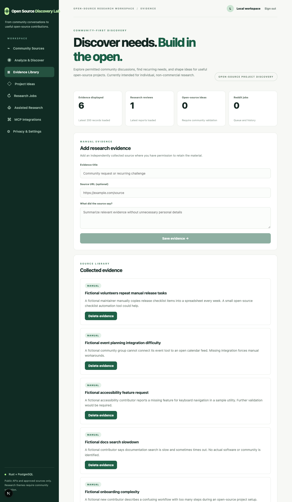
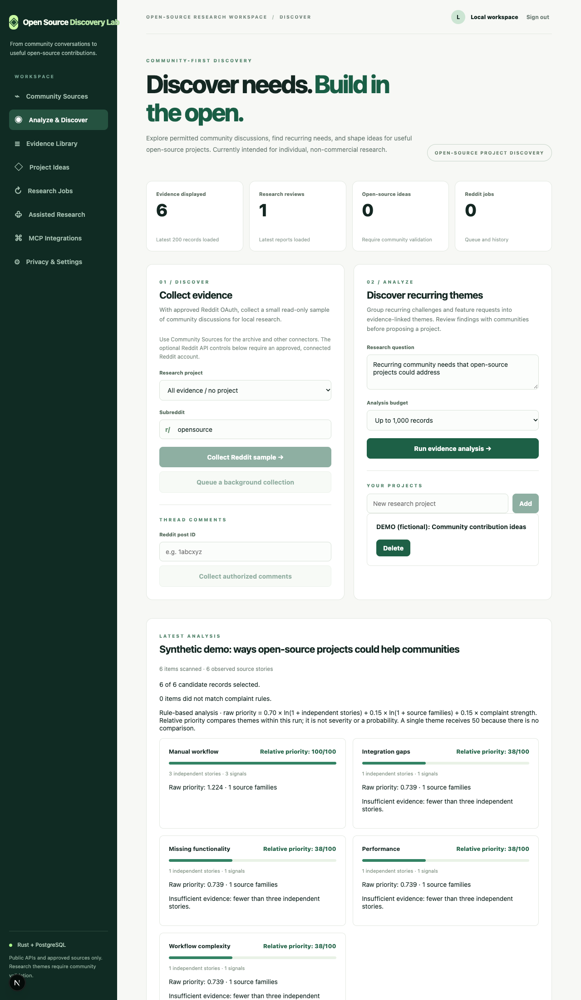
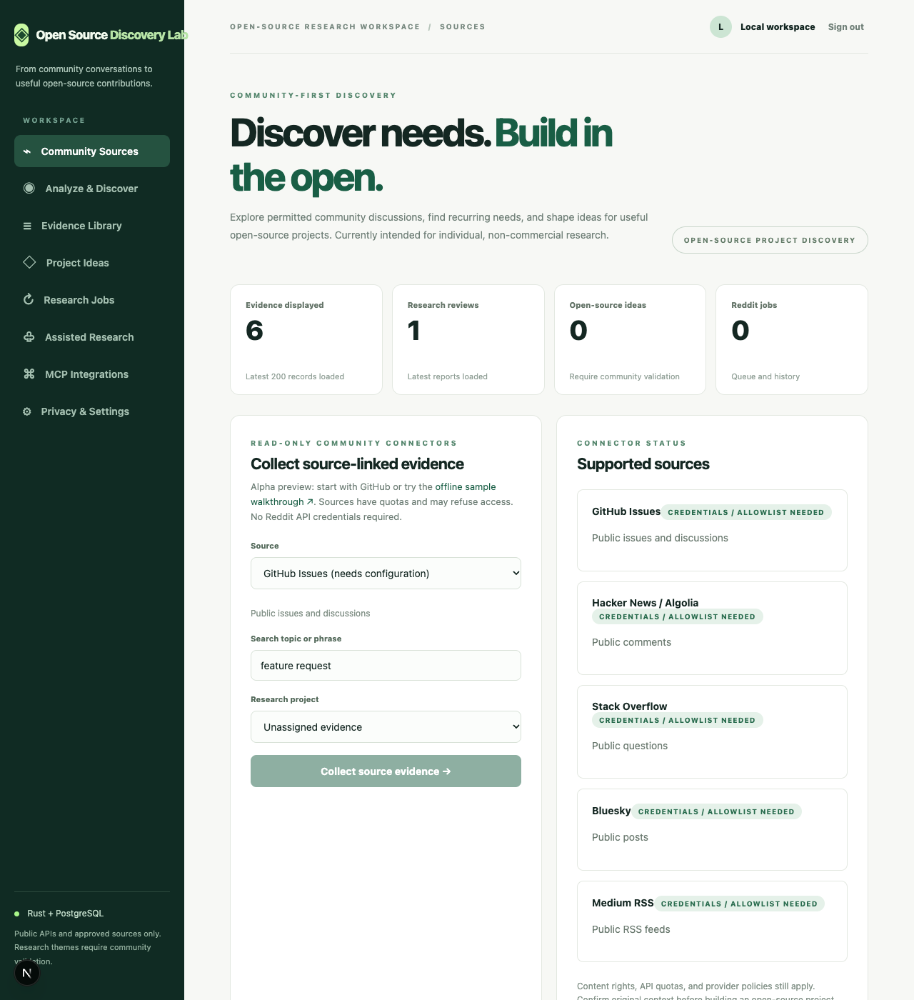

# Five-minute demo (fictional evidence; no external APIs)

This is a **reproducible local demonstration**, not a live feed or a claim about any real community member. It seeds six
synthetic research observations into your _own_ local workspace and runs the built-in heuristic analysis. It does not
access Reddit, GitHub, Medium, or any third-party website.

## Prerequisites

- Docker Engine and Docker Compose v2
- `curl`, `jq`, and OpenSSL
- A local checkout of this repository

## 1. Configure secrets

From the repository root:

```bash
cp .env.example .env
openssl rand -hex 32
openssl rand -hex 32
```

Place **different** generated 64-character hex values in the `TOKEN_ENCRYPTION_KEY_HEX` and `LOCAL_LOGIN_TOKEN` fields
of `.env`. Set a strong `POSTGRES_PASSWORD`. Never commit or share `.env`.

No Reddit approval, YouTube key, GitHub token or API account is required.

## 2. Start services

```bash
docker compose up --build -d --wait
curl --fail-with-body http://localhost:3000/api/health
```

If the health check fails, inspect `docker compose logs --tail=100`.

## 3. Run the example

```bash
bash scripts/try-demo.sh
```

The script creates **one new project** labeled `DEMO (fictional): Community contribution ideas`, loads six records from
`examples/demo-evidence.json`, and saves a research report. Repeating it creates another demo project rather than altering
your real projects.

Expected outcome (exact score percentages depend on the active scoring engine version):

```text
Success: created an explicitly fictional demo project with 6 evidence items.
Project ID: <project-uuid>
Theme groups (heuristic, not verified needs):
  - Manual workflow: 3 supporting demo item(s)
  - Integration gaps: 1 supporting demo item(s)
  - Missing functionality: 1 supporting demo item(s)
  - Performance: 1 supporting demo item(s)
  - Workflow complexity: 1 supporting demo item(s)
Open http://localhost:3000, sign in locally, then choose Evidence Library or Analyze & Discover.
To remove the synthetic items, delete the DEMO project and its evidence in the dashboard.
```

Open [http://localhost:3000](http://localhost:3000) and log in with your `LOCAL_LOGIN_TOKEN`.

---

## Onboarding visual walkthrough

The screenshots below illustrate what the dashboard displays after running the synthetic demonstration. **All data shown is completely invented** to demonstrate interface behavior safely without network calls or personal information.

### 1. Evidence Library (Viewing synthetic records)

Navigate to **Evidence Library** in the sidebar. You will see the six loaded demo records categorized under the demo project:



*Figure 1: The Evidence Library displays ingested observations with their source provenance (`MANUAL`), titles, and excerpts. You can inspect or delete individual evidence items without touching real project research.*

Key elements visible in the Evidence Library:
- **Workspace scope:** The top bar reflects your local authenticated session (`Local workspace`).
- **Manual evidence intake:** Form to manually record user observations or community suggestions.
- **Source list:** Displays the six synthetic observations from `examples/demo-evidence.json` (e.g., manual release checklists, calendar integration, keyboard navigation, documentation timeouts, and onboarding complexity).

### 2. Analyze & Discover (Theme clustering report)

Select **Analyze & Discover** to review the theme report generated by the analysis run:



*Figure 2: The theme report groups the six synthetic observations into recurring problem categories with relative priority scores and explicit evidence counts.*

Key elements visible in the theme report:
- **Audit summary:** Displays `6 items scanned · 6 observed source stories` and notes coverage details.
- **Scoring formula transparently stated:** Explains the rule-based calculation (`raw priority = 0.70 × ln(1 + independent stories) + 0.15 × ln(1 + source families) + 0.15 × complaint strength`).
- **Theme cards:**
  - **Manual workflow** ranks highest with **3 independent stories** (relative priority 100/100, meeting the 3-story threshold for sufficient evidence).
  - **Integration gaps**, **Missing functionality**, **Performance**, and **Workflow complexity** each have **1 independent story** (relative priority 38/100), explicitly marked with *Insufficient evidence: fewer than three independent stories*.

### 3. Community Sources (Exploring permitted connectors)

Once familiar with the demo interface, navigate to **Community Sources** to inspect the read-only community connectors:



*Figure 3: Supported community connectors available for read-only research.*

---

## 4. Then try a real permitted source

Select **Community Sources** and choose **GitHub Issues**. Try the query `"feature request" integration`. Public GitHub
access is subject to rate limits and may fail; an optional GitHub token can be configured in `.env`. The result is an
observation, **not** proof of demand. See [Source connectors](SOURCES.md).

## 5. Clean up

Delete the demo evidence individually in **Evidence Library**. Deleting a project by itself **does not delete
evidence**; it only unassigns the records. If this is a throwaway install and you need to erase _all_ local data, use
the account deletion option in **Privacy & Settings** or stop services and explicitly remove Docker volumes with
`docker compose down -v`. The latter also destroys _real_ local data; never use it on a workspace you want to keep.

## Report your first-run outcome

Please use the repository's [bug report template](https://github.com/savisaluwadana/Pain-Point-Analyzer/blob/main/.github/ISSUE_TEMPLATE/bug_report.yml) to report an error, or the
[feedback template](https://github.com/savisaluwadana/Pain-Point-Analyzer/blob/main/.github/ISSUE_TEMPLATE/feedback.yml) if the setup works. Do not attach personal tokens or
third-party post text. Helpful feedback includes OS, Docker version, the step that failed, and whether the synthetic
report displayed at least one theme.
