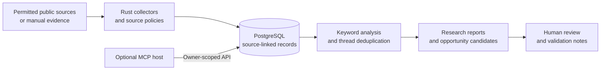

<p class="hero-eyebrow">Local-first · Open source · Community research</p>

<h1 class="hero-title">Understand recurring problems.<br>Build useful open-source solutions.</h1>

<p class="hero-lead">
Open Source Discovery Lab is a Rust, Next.js, and PostgreSQL workspace for
exploring permitted, source-linked community discussions. It helps independent
developers find recurring pain points, inspect original evidence, and decide
whether to contribute to an existing project or validate a new idea.
</p>

[**Try the five-minute demo**](GETTING_STARTED.md){ .md-button .md-button--primary }
[**Explore the source code**](https://github.com/savisaluwadana/Pain-Point-Analyzer){ .md-button }

<div class="status-strip">
**Project status:** early community alpha · local, individual, currently non-commercial research.
This is a public **documentation website**, not a hosted instance of the research application.
Do not expose the current application to the internet.
</div>

## What you can do

<div class="grid cards" markdown>

-   **1. Collect bounded evidence**

    ---

    Research public GitHub Issues, Hacker News, Stack Overflow, Bluesky, YouTube comments,
    allowlisted Discourse forums, Medium RSS, and optional Reddit archive samples.
    Every provider has separate rights, quotas and access limitations.

    [Explore source connectors](SOURCES.md)

-   **2. Identify recurring themes**

    ---

    Group repeated observations into eight auditable keyword-based categories, while
    deduplicating known provider threads and identical long copies. Inspect
    ranking factors and incomplete coverage.

    [How analysis works](ANALYSIS_QUALITY.md)

-   **3. Review opportunities**

    ---

    Open an opportunity brief with current, hash-verified representative evidence.
    Record existing alternatives, your own validation notes and a manual build/no-build
    decision, without representing a priority score as market demand.

    [Opportunity review workflow](OPPORTUNITY_REVIEW.md)

-   **4. Extend with MCP**

    ---

    Connect a compatible research host through a revocable API key.
    Host-provided reasoning and browsing remain optional and distinct from the
    local keyword engine.

    [MCP integration](MCP.md)

</div>

## How the system works



The browser UI is a Next.js application, the backend is Rust/Axum, and data
lives in PostgreSQL 17. The optional AI host does not run inside the default
Docker Compose stack. The proposed local semantic-embedding engine is **not yet
shipped**. See [architecture](ARCHITECTURE.md), [API reference](API_REFERENCE.md),
and the [current roadmap](ROADMAP.md).

## Start with the safest demonstration

```bash
git clone https://github.com/savisaluwadana/Pain-Point-Analyzer.git
cd Pain-Point-Analyzer
cp .env.example .env
# Generate three separate secrets; see the setup guide before proceeding.
docker compose up --build -d --wait
bash scripts/try-demo.sh
```

The demo uses **six fictional evidence items** and requires no external
collection credentials. Follow the full [configuration steps](GETTING_STARTED.md)
first; the above commands alone will not populate your secret values.

## Documentation map

- **For users:** [installation](GETTING_STARTED.md), [guided workflows](USER_GUIDE.md), [provider details](SOURCES.md)
- **For contributors:** [development and CI](DEVELOPMENT.md), [module architecture](ARCHITECTURE.md), [data model](DATA_MODEL.md)
- **For integrations:** [HTTP API](API_REFERENCE.md), [MCP host setup](MCP.md), [MCP tool index](MCP_TOOL_INDEX.md)
- **For operators:** [backups and troubleshooting](OPERATIONS.md), [security](SUPPORT_AND_SECURITY.md), [data-use policies](PURPOSE_AND_DATA_USE.md)

!!! warning "Evidence is not demand"
    Repeated complaints do not establish customer budgets, purchase intent, statistical confidence,
    or permission to contact the people who posted them. Read contradictory evidence and source terms
    before choosing a solution. The project's MIT software license does not license third-party data.
