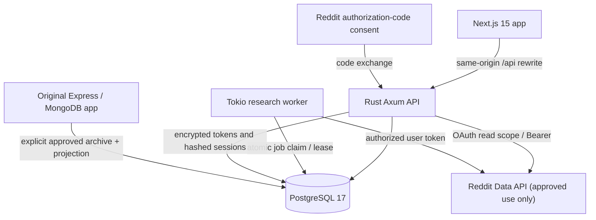
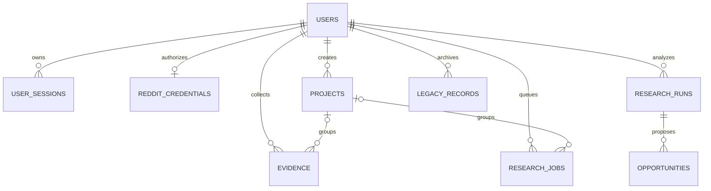
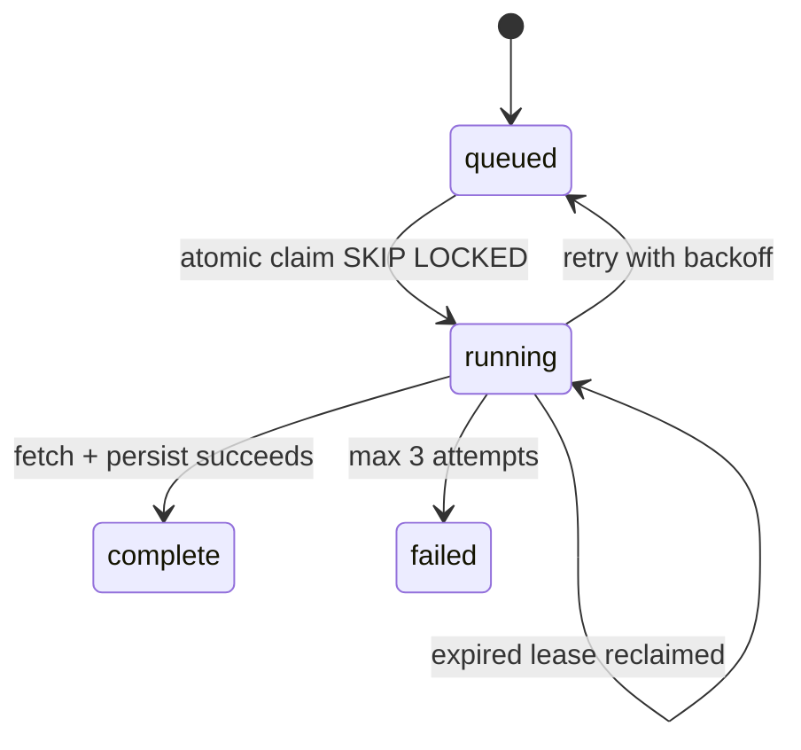

# V2 architecture, lifecycle and migration gates

## Runtime map

The v2 Rust API is a **modular monolith**, not a cluster of separate microservices. Tokio provides asynchronous I/O and the worker. Next.js has no direct database access. All user-facing requests use an opaque secure cookie. Reddit access tokens/refresh tokens are *never* sent to the browser.

## Security lifecycle

1. The operator supplies registered/approved Reddit client credentials and declares access with `REDDIT_API_APPROVED`.
2. User clicks **Connect Reddit**; Rust sets a random HttpOnly OAuth-state cookie and requests `identity read` consent.
3. After callback, Rust compares the returned state against the cookie, exchanges the authorization code through HTTPS and uses the approved OAuth identity endpoint.
4. The identity becomes a `users` record. Tokens are encrypted using ChaCha20-Poly1305 with a random 96-bit nonce and a server-held 256-bit key. Only an opaque randomly generated session token is returned to the browser; the SHA-256 digest is stored server-side.
5. Session-authenticated requests are scoped to the corresponding `owner_id`. The Rust connector refreshes expired access tokens in the backend and uses fixed Reddit API paths, bounded result counts, descriptive User-Agent and provider 429 handling.
6. New Reddit evidence is removed after `REDDIT_RETENTION_DAYS` (default 7) through hourly cleanup. This is a maximum local retention window, **not** a substitute for prompt removal requests from Reddit or users.
7. `POST /api/privacy/delete-data` cascades all owner-specific data and clears the cookie. Local sign-out deletes the session row. A separate refresh-token revocation flow and Reddit-side deletion reconciliation are future security work.

## Data model

V2 uses UUID primary keys and database-enforced owner FKs. The unique evidence key is `(owner_id,source_kind,source_id)`, preventing duplicate source ingestion for a given user.

`legacy_records` preserves historical source collection names and original IDs when v1 data is explicitly imported. Imported evidence is marked `legacy-reddit` or `legacy-import`, never confused with an OAuth-authorized v2 collection.

## Research job lifecycle

Every claim creates a UUID lease token. Only its owner can mark the job complete/fail; the DB query checks the token. There is no retry storm on OAuth/Reddit failures; requests reporting 429 receive a longer cooldown.

### Evidence quality invariant

`scoring::analyze` groups known keywords into categories for initial triage. Every Reddit post/comment belonging to the same root conversation is **one independent story**. E.g. 50 comments in one thread are not 50 independent customer complaints. This is an explicitly heuristic signal; it does not predict revenue or prove product-market fit. Long-lived reports contain category metrics and evidence identifiers, not raw Reddit excerpts.

## Cutover criteria

| Component | V1 | V2 | Gate |
| --- | --- | --- | --- |
| Basic Reddit post collection | Public .json relay | OAuth read token | Approved app credentials, rate & privacy review |
| Comment collection | Browser / thread APIs | Bounded OAuth comment import | Nested-thread tests and access approval |
| Manual evidence | Express/Mongo | Rust/Postgres | Contract & limits review |
| Pain scoring | Browser + Node | Rust heuristic clusters | Side-by-side qualitative evaluation |
| Jobs | Node / host claimed | Tokio queue & leases | Concurrency and crash recovery tests |
| Projects / opportunity list | Express/Mongo | SQLx Postgres | Data migration counts, API contracts |
| 57 MCP tools | JS stdio bridge | **Not migrated** | Full schemas, integration/evaluation tests |
| Autonomous host intelligence | JS + model host | **Not migrated** | Model-provider abstraction and provenance |
| Source scraping + quality intelligence | JS modules | **Not migrated** | Authorized adapters / score parity |
| Advanced Opportunity OS | JS modules | **Not migrated** | Workflow & experiment persistence |

**Production cutover must remain blocked** until the final four rows reach parity, historical data is reconciled, appropriate Reddit permission is secured and all security requirements pass. This PR intentionally does not remove the working v1 app.
